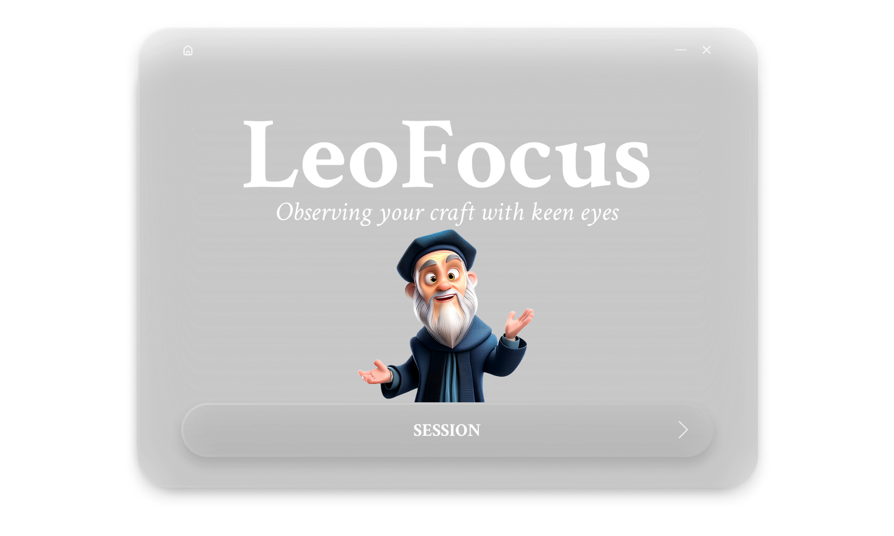
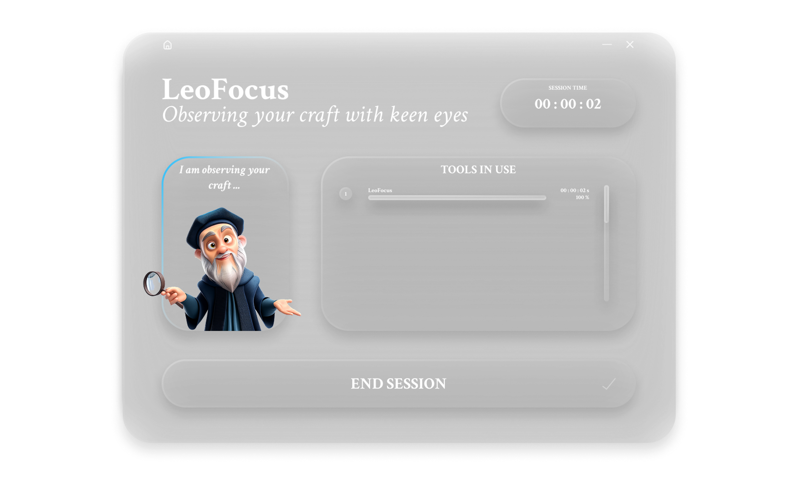
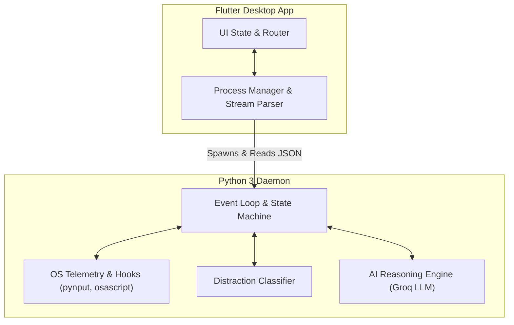

# LeoFocus: Context-Aware Focus Tracking System

This repository contains the core system and methodology for **LeoFocus**, an intelligent, real-time focus-tracking application developed as a research initiative exploring Human-Computer Interaction (HCI), Real-Time OS Telemetry, and Generative AI Coaching.

**Academic Context**: Developed within Creativity, Science and Innovation 2025/26 coursework at **Politecnico di Milano**.

## Product Overview

Unlike traditional focus apps that suffer from **context blindness** (e.g., blocking YouTube entirely regardless of whether it is used for entertainment or educational tutorials), LeoFocus uses real-time OS telemetry and an LLM reasoning engine to dynamically evaluate user intent. By analyzing active window titles, document metadata, and physical input cadence, the application acts as an active, context-aware mentor that delivers instant 30-second feedback and intervenes only when true off-task behavior occurs.

## Project Achievements & Validation

LeoFocus has been validated not just as an academic project, but as a viable product concept:
* **Pitch & Corporate Review**: Presented to **Amazon Italy**.
* **Academic Showcase**: Exhibited at the **LIRE Research Event** (Politecnico di Milano).
* **Incubation & Funding**: Selected for the **TEF Ignition Program** (joint program by Bocconi University & Politecnico di Milano), securing **€2,000** in seed funding.

> **Note on Codebase (MVP)**: This repository contains the Minimum Viable Product (MVP) developed during the research and validation phase. The architecture and code reflect a proof-of-concept aimed at rapid prototyping, telemetry validation, and immediate user testing.

## User Research & Interface Design

The application's interface and overall User Experience were iteratively designed following qualitative evaluations and user testing conducted with students from both **Politecnico di Milano** and **Bocconi University**. 

Based on user feedback, the UI was engineered with a **minimalist, semi-transparent overlay aesthetic** specifically crafted to stay accessible on-screen during deep work without creating visual friction or cognitive overload.

  <!-- Sostituisci i percorsi src con quelli effettivi dei tuoi screenshot -->
  
  
   
  <em>Figure 1: Main View and Session View interfaces.</em>

> **Design credit:** UI/UX and visual assets by **Michele Castelletti** ([LinkedIn](https://www.linkedin.com/in/michele-castelletti-management-engineering-and-system-design/)).

## System Architecture

LeoFocus operates on a decoupled **Desktop Client–Background Daemon** architecture to ensure low-level system monitoring without blocking the UI thread.

**Frontend (Flutter Desktop)**
Handles the UI state, user goal initialization, and renders real-time telemetry. It acts as the process manager, spawning and communicating with the backend.

**Backend (Python 3 Daemon)**
Executes low-level event collection, distraction classification, and LLM orchestration. 
* **OS Telemetry**: Utilizes native OS queries (`osascript` on macOS, `win32com` on Windows) to extract active window titles, document names, and physical input cadence via `pynput`.
* **LLM Engine**: Integrates a Groq-powered API (`Llama-3.1-8B`) for ultra-low latency, real-time session evaluation.
* **IPC Protocol**: Communication between Flutter and Python is fully asynchronous, utilizing structured JSON lines over `stdout` / `stdin` Streams.

## Methodology: The Deterministic Guardrail

To eliminate LLM hallucinations and prevent overly lenient focus evaluations, the backend enforces a deterministic mathematical guardrail. If the LLM assigns a focus score higher than what is realistically possible given the user's actual distraction metrics, the system automatically caps the score:

$$
\text{Max Allowed Score}=\min\Big(100\,(100-\text{Recent Distraction Percentage})+10\Big)
$$

This ensures that the coaching feedback remains strictly accountable to the raw OS telemetry data.

---

## Tech Stack

- **Frontend:** Flutter (Dart ^3.10.0), Provider, Google Fonts
- **Backend:** Python 3.9+
- **Telemetry:** `pynput`, `pygetwindow`, `pywin32`
- **AI Integration:** Groq SDK (`llama-3.1-8b-instant`)

---

## Authors

- **Pau Fernández Cester** — MSc AI @ PoliMi — [LinkedIn](https://www.linkedin.com/in/pau-fern%C3%A1ndez-cester-9b7053252/) | [GitHub](https://github.com/PauFdz)
- **Filippo Galletta** — MSc Computer Science @ EIT Digital (PoliMi, KTH) — [LinkedIn](https://www.linkedin.com/in/filippo-galletta/) | [GitHub](https://github.com/filippogalletta)
- **David Ravelli** — MSc Data Science @ EIT Digital (PoliMi, Aalto) — [LinkedIn](https://www.linkedin.com/in/david-ravelli-2900a6252/) | [GitHub](https://github.com/dvd32)
